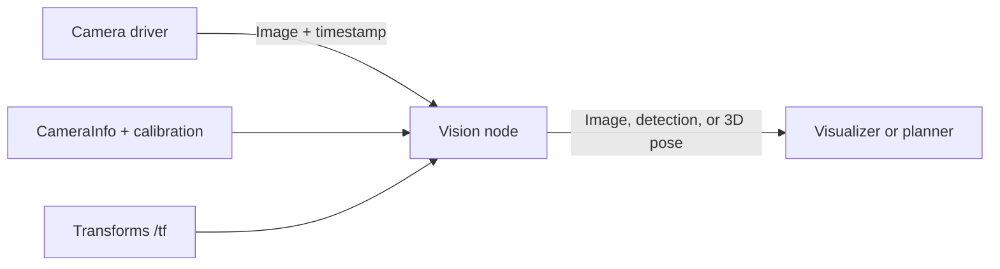

# ROS 2 Vision Workflow

## Learning objectives

Trace an image from a ROS 2 camera topic through a processing node, preserve timestamps and frame information, and inspect the running pipeline.

## 1. ROS 2 graph basics

A ROS 2 **node** is a process/component with a focused responsibility. Nodes exchange **messages** over named **topics**: publishers send, subscribers receive. Common vision messages include `sensor_msgs/Image`, `sensor_msgs/CameraInfo`, and `sensor_msgs/PointCloud2`. Services and actions are used for request/response or longer-running tasks.

Every stamped sensor message has a timestamp and often a `frame_id`. Those fields are part of the data's meaning. Do not discard them just to make code run.

## 2. Discover and inspect topics

With the robot or a bag replay running, inspect the graph:

```bash
ros2 topic list
ros2 topic info /camera/image_raw
ros2 topic hz /camera/image_raw
ros2 topic echo /camera/camera_info --once
```

Replace topic names with those from your system. Check message type, publishing rate, frame ID, image dimensions, encoding, and QoS compatibility. Sensor publishers often use best-effort QoS to avoid blocking on slow consumers; a subscriber with incompatible reliability settings may receive nothing.



## 3. Convert and process images

`cv_bridge` converts ROS image messages to OpenCV arrays and back. A callback fragment for a grayscale/edge topic might look like this:

```python
from cv_bridge import CvBridge
import cv2

bridge = CvBridge()

def image_callback(msg):
    image_bgr = bridge.imgmsg_to_cv2(msg, desired_encoding="bgr8")
    gray = cv2.cvtColor(image_bgr, cv2.COLOR_BGR2GRAY)
    edges = cv2.Canny(gray, 60, 140)
    output_msg = bridge.cv2_to_imgmsg(edges, encoding="mono8")
    output_msg.header = msg.header  # preserve time and frame for same-sized pixel data
    publisher.publish(output_msg)
```

This is only the callback; a full node must create the publisher/subscriber and handle shutdown and exceptions. If the algorithm crops, resizes, rectifies, or changes camera geometry, update the associated calibration/metadata rather than blindly copying `CameraInfo`.

## 4. Record, replay, and visualize

Record sensor topics to a ROS bag so experiments can be replayed consistently:

```bash
ros2 bag record /camera/image_raw /camera/camera_info /tf /tf_static
ros2 bag play BAG_FOLDER
```

Replace `BAG_FOLDER` with the path to the recorded bag. Visualize the raw and processed topics in an image viewer. Compare timestamps and rates. Replaying a bag is useful for iteration, but it does not reproduce every live timing or hardware condition.

## 5. Debug from input to output

Check one boundary at a time: camera publishes → subscriber receives → conversion succeeds → processing produces expected shape/type → publisher emits → viewer displays. Log throttled summaries such as dimensions, encoding, and processing time; avoid dumping full image arrays. Monitor queue depth, dropped messages, and end-to-end delay.

## Practice

Run a camera or bag publisher, inspect its image and camera-info topics, and create an edge-image output. Verify the output dimensions, encoding, timestamp, and frame ID. Compare processing delay with the input frame period. Do the first experiment offline or in simulation.

## Common mistakes

- Debugging computer vision before confirming the topic type, encoding, and QoS.
- Copying a frame ID or calibration after resizing/cropping without updating geometry.
- Processing stale queued frames while assuming they are current.
- Testing only live and being unable to replay a failure.
