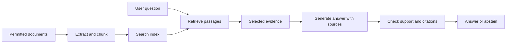

# RAG, Evaluation, and Safety

## Learning objectives

Design a retrieval-augmented generation (RAG) system, separate retrieval quality from answer quality, and test failure cases before release.

## 1. The RAG pipeline

A typical pipeline has two phases:

1. **Index:** collect permitted documents, extract text, split into passages, attach source metadata, create embeddings or a lexical index, and store the result.
2. **Answer:** interpret a question, retrieve relevant passages, optionally rerank them, place selected evidence in the model context, and generate an answer with source references.

The retrieval step does not make an answer grounded by itself. The model may ignore evidence, misread it, or invent a conclusion.

## 2. Chunking and retrieval

Very small chunks lose context; very large chunks may dilute relevance or exceed the context budget. Preserve titles, page numbers, dates, and permissions as metadata. Test chunk sizes on realistic queries. Compare lexical search (good for exact terms) and vector search (good for semantic similarity); a hybrid can help. Use only data the system is allowed to retrieve.

## 3. Evaluate each stage

- **Retrieval:** recall@k, precision@k, or reciprocal rank on questions with known relevant passages.
- **Answer:** correctness, completeness, groundedness, citation validity, and appropriate abstention.
- **System:** latency, cost, availability, privacy, and behavior under abuse or malformed input.

Build a small, reviewed evaluation set that reflects real question types and includes questions whose answers are absent. Keep it separate from prompt and retrieval tuning where possible. Automatic graders are useful signals, not perfect judges; review a sample manually.

## 4. Cite and abstain

Ask the model to answer only from retrieved evidence and identify the source for each factual claim. Validate that cited passages exist and were actually retrieved. If evidence is missing or conflicting, the system should say so or ask a clarifying question rather than confidently guessing.

## 5. Security and privacy

Retrieved documents and user queries are untrusted input. A malicious passage may contain instructions aimed at the model (prompt injection). Delimit retrieved text, instruct the model to treat it as data, restrict tools, and never let untrusted content grant permissions. Remove secrets and unnecessary personal data from logs. Control document access before retrieval, not only after an answer is generated.

## Practice

Create 10 questions over a small set of documents: answerable, ambiguous, unanswerable, and adversarial. For each, record expected evidence and desired behavior. Evaluate retrieval separately from the final response. Include at least one example where the best answer is “I cannot find enough evidence.”

## Common mistakes

- Using only plausible-looking examples and no unanswerable questions.
- Measuring answer text while ignoring whether the retrieved passage was relevant.
- Trusting generated citations without checking they support the claim.
- Treating prompt wording as a security boundary for privileged tools.
