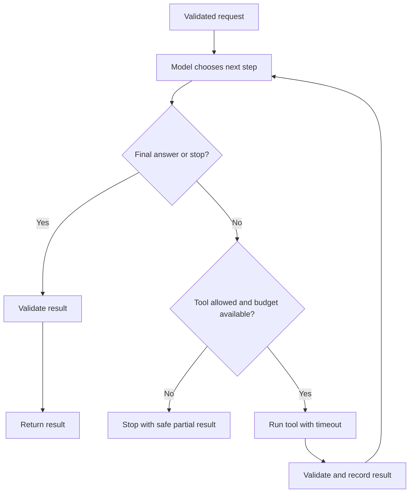

# Agent Workflows and Tools

## Learning objectives

Choose between a fixed workflow and an agent, design narrow tool interfaces, and bound a model-directed loop.

## 1. Workflow or agent?

A **workflow** follows a predetermined sequence: retrieve data, summarize it, validate a schema, return a result. An **agent** uses a model to choose one or more next actions based on observations. Workflows are usually easier to test and operate. Use an agent only where flexible decisions add value that cannot be handled simply.

## 2. Define the task boundary

Specify the task, allowed tools, information the system can access, expected output, and stop condition. Give every run a step budget, time limit, and token/cost limit. Ask what happens if the model refuses, returns invalid output, or repeats an action.

## 3. Tool design

A tool should have a narrow purpose and typed schema. Validate arguments before execution and validate results before sending them back to the model. Add timeouts and clear errors. Prefer idempotent actions (repeating them has no extra effect) for retries. Use least privilege: a read-only search tool is safer than arbitrary shell or filesystem access.

Example tool contract:

```text
search_docs(query: string, top_k: integer 1..5)
  -> list of {title, excerpt, source_id}
```

Keep credentials outside prompts. A structured tool call is still untrusted model output; enforce permissions in program code.

## 4. A bounded loop



```text
state = validated user request
for step in 1..MAX_STEPS:
    decision = model(state, allowed_tools)
    if decision is final: validate and return
    if tool is not allowed: stop safely
    result = run tool with timeout and permission checks
    state = append observation and tool result
return a clear incomplete result
```

Log enough to debug (model/version, tool name, timing, outcome) while minimizing sensitive content. Never treat retrieved documents as trusted instructions.

## 5. State and memory

Context is not the same as reliable memory. Store only information needed for the task, with clear ownership, retention, and deletion rules. Summaries can omit or alter facts; retain source references for important claims. Keep the state machine explicit where possible.

## Practice

Design an agent that searches public documentation and drafts an answer but cannot write or send messages. Specify its tools, schemas, max steps, error handling, and final output validation. Compare it to a fixed retrieval-plus-answer workflow.

## Common mistakes

- Giving a model broad tools when a few specific functions would work.
- Allowing unbounded loops, retries, or spending.
- Treating a valid JSON response as evidence that an action is safe.
- Hiding failures or returning made-up success after a tool timeout.
