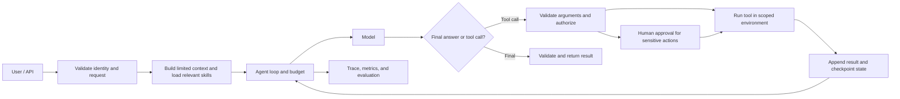

# Agent Harness Design and Runtime

## Learning objectives

Explain the system around an agent model call, design a bounded and observable tool loop, and improve a harness using evidence from real failures.

## 1. Harness is a system boundary

The word **harness** is used at different scopes. In one common definition, it is the prompt, tools, and middleware around the model loop. In a production application, the harness may also include input/context construction, tool dispatch, state and checkpoints, permissions, sandboxing, human approval, budgets, logging, traces, and output validation. State which definition a design document uses.

An agent is not only a model. Its observed behavior comes from the model, task instructions, available information, tool schemas, runtime, policies, model/provider settings, and evaluation environment.

## 2. The control loop

1. Authenticate the caller and validate the request.
2. Select task-specific instructions, tools, and only relevant context.
3. Call the model with an explicit step/time/token/cost budget.
4. If the response requests a tool, validate the schema and authorize the exact resource/action.
5. Execute with timeout, isolation, and idempotency controls; capture a structured result.
6. Add the observation to state and continue, or stop on completion, budget, or failure.
7. Validate the final output and report partial/failure states honestly.

The model proposes actions. Deterministic application code decides whether the action is allowed and what actually executes.

## 3. State, memory, and long-running work

Conversation history, working state, and durable memory are different:

- **History** is the messages/events for a conversation.
- **Working state** contains current task variables, progress, tool results, and pending approvals.
- **Checkpoint** lets a run recover or resume after interruption.
- **Long-term memory/store** holds selected facts across runs and needs retention, correction, and access rules.
- **Artifacts** such as a plan, task list, or report can hand work to a fresh context/session.

For long jobs, split work into verifiable units, record what is done/next/blocked, checkpoint before or after side effects, and verify an external outcome. Context summarization can reduce history; it is not a replacement for durable state. A fresh session with a clear handoff can help when a task spans many context windows.

## 4. Guardrails in the harness

Enforce limits outside free-form model text: tool allowlists, identity and resource authorization, input/output schemas, file/network boundaries, timeouts, retry caps, rate limits, spend limits, and human approval for irreversible actions. Use idempotency keys for operations that can be retried. Treat retrieved documents and tool output as untrusted data.

## 5. Observe the complete run

Trace model calls, tool arguments/results, state transitions, approvals, retries, latency, and costs. Redact secrets and minimize stored personal data. A transcript alone may not prove a requested action happened; verify the outcome in the target system. Make traces useful enough to classify failure as model choice, context, tool, permission, state, or environment.

## 6. Improve with controlled experiments

Start with the simplest architecture that solves the task. Build an evaluation set, record baseline success and failure categories, then add one harness component (for example, retrieval, a validator, a checkpoint, or a specialist agent) and measure what changed. Reassess after model/provider upgrades: old scaffolding can become unnecessary or introduce new failure modes.

## Practice

Design a research agent that can search approved public sources and save a draft locally. Specify context sources, tool permissions, maximum steps/cost, checkpoint format, approval boundary, trace fields, final validation, and the evaluation outcome that proves the draft exists.

## Common mistakes

- Giving the model a broad tool and relying on the prompt to limit it.
- Making every task autonomous, multi-agent, and long-running before a baseline exists.
- Treating a summary as a durable checkpoint of side effects and task status.
- Adding guardrails that are not measured or integrated with application authorization.
- Keeping a complex harness after model changes without checking whether each part still helps.

## Further reading

- [LangChain: agents and harnesses](https://docs.langchain.com/oss/python/langchain/agents)
- [Anthropic: effective harnesses for long-running agents](https://www.anthropic.com/engineering/effective-harnesses-for-long-running-agents)
- [Anthropic: harness design for long-running applications](https://www.anthropic.com/research/harness-design-long-running-apps)
