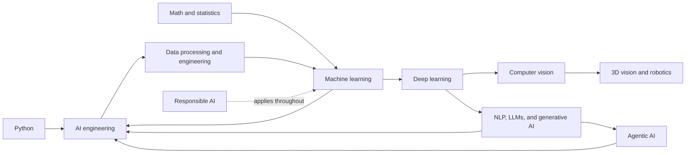

# Curriculum Map

The curriculum moves from shared foundations to focused applications. Each subject page lists learning objectives, prerequisites, a suggested lesson order, and a project checkpoint. The course is self-paced; the sequence is a guide rather than a schedule.

## Shared foundations

1. [Start here](00-start-here/README.md)
2. [Python and computing](02-python/README.md)
3. [Mathematics for AI](01-math/README.md)
4. [Data processing and engineering](03-data/README.md)
5. [Machine learning](04-machine-learning/README.md)
6. [Deep learning](05-deep-learning/README.md)

Math can be studied in parallel with Python. Data processing should come before model training so that data quality, splitting, and leakage are understood from the start.

## Specializations and supporting practice

- [Computer vision](06-computer-vision/README.md) → [3D vision and robotics](07-3d-vision-robotics/README.md)
- [NLP, LLMs, and generative AI](08-nlp-llms/README.md) → [Agentic AI](10-agentic-ai/README.md)
- [Reinforcement learning](09-reinforcement-learning/README.md)
- [AI Engineering](11-ai-engineering/README.md) applies across the specializations.
- [Responsible AI](12-responsible-ai/README.md) should be considered throughout the entire curriculum.

## What a complete module should contain

The English first edition now contains guided lessons, worked examples, practice prompts, common failure modes, and links to primary documentation across the main areas. The modules will continue to grow with deeper exercises, code labs, and reviewed capstone walkthroughs.

## Expanded lesson index

All lessons live inside their subject folder; advanced chapters do not create separate course folders.

- **Mathematics:** [calculus and linear-regression gradients](01-math/02-calculus-and-optimization.md), [statistical inference](01-math/04-statistical-inference-and-experiment-design.md), [linear algebra, least squares, PCA, and SVD](01-math/05-linear-algebra-for-machine-learning.md), [information theory and numerical methods](01-math/06-information-theory-and-numerical-computation.md), [probability distributions and Bayes](01-math/07-probability-distributions-and-bayes.md), [likelihood, MLE, and MAP](01-math/08-likelihood-mle-and-map.md), [convex optimization](01-math/09-convex-optimization-and-constraints.md), and the [formula cheatsheet](01-math/FORMULA_CHEATSHEET.md).
- **Python and data:** [Python foundations, OOP, and DSA sequence](02-python/README.md); [core language](02-python/04-python-core-language.md); [OOP](02-python/06-object-oriented-programming.md); [complexity](02-python/07-recursion-and-complexity.md); [linked lists](02-python/09-linked-lists-stacks-and-queues.md); [BSTs and heaps](02-python/11-trees-bst-and-heaps.md); [graphs](02-python/12-graphs-and-graph-algorithms.md); then [feature engineering](03-data/04-data-cleaning-eda-and-feature-engineering.md), [SQL and dataset construction](03-data/05-sql-and-dataset-construction.md), [ETL/ELT](03-data/07-etl-elt-pipelines-and-orchestration.md), and [data quality and feature stores](03-data/09-data-quality-feature-stores-and-streaming.md).
- **ML and DL:** [ML validation](04-machine-learning/04-generalization-validation-and-model-selection.md), [linear regression](04-machine-learning/07-linear-regression-and-gradient-descent.md), [logistic regression and softmax](04-machine-learning/08-logistic-regression-perceptron-and-softmax.md), [k-NN and k-means](04-machine-learning/09-knn-and-k-means.md), [SVM](04-machine-learning/10-support-vector-machines.md), [PCA/SVD](04-machine-learning/11-pca-svd-and-dimensionality-reduction.md), [trees and Naive Bayes](04-machine-learning/12-decision-trees-and-naive-bayes.md), and [recommendation systems](04-machine-learning/13-recommendation-systems.md).
  Deep-learning derivations cover [backpropagation](05-deep-learning/05-backpropagation-worked-example.md), [CNN convolution](05-deep-learning/06-convolution-and-cnn-shapes.md), [transformer attention](05-deep-learning/07-attention-and-transformers-by-hand.md), [generative models](05-deep-learning/08-generative-models-foundations.md), [training](05-deep-learning/03-training-deep-networks-in-practice.md), and [network design and losses](05-deep-learning/04-neural-network-design-losses-and-diagnostics.md).
- **Vision and robotics:** [CV evaluation](06-computer-vision/04-detection-segmentation-and-error-analysis.md), [image pipelines](06-computer-vision/05-image-pipelines-and-vision-training-workflow.md), [stereo and SLAM](07-3d-vision-robotics/04-stereo-visual-odometry-slam-and-point-clouds.md), and [point-cloud learning](07-3d-vision-robotics/05-point-cloud-processing-and-deep-learning.md).
- **NLP, LLMs, and agents:** [classical NLP](08-nlp-llms/02-classical-nlp-sequence-models-and-evaluation.md), [LLM foundations](08-nlp-llms/03-llm-foundations-and-inference.md), [prompting](08-nlp-llms/04-prompt-design-and-structured-outputs.md), [retrieval](08-nlp-llms/05-retrieval-engineering.md), [fine-tuning](08-nlp-llms/06-fine-tuning-and-model-adaptation.md), [LLM evaluation](08-nlp-llms/07-llm-evaluation-safety-and-cost.md), [RAG evaluation](08-nlp-llms/08-rag-evaluation-and-safety.md), [RAG observability](08-nlp-llms/09-rag-evaluation-and-observability.md), the [RAG system lab](08-nlp-llms/10-rag-system-worked-lab.md), [advanced retrieval patterns](08-nlp-llms/11-advanced-rag-retrieval-patterns.md), and [policy-gradient RL](09-reinforcement-learning/03-policy-gradients-actor-critic-and-practice.md).
- **AI Engineering:** all software engineering, MLOps, and AI systems lessons are in [one module](11-ai-engineering/README.md), including [model lifecycle](11-ai-engineering/04-model-lifecycle-testing-and-monitoring.md), [inference latency and cost](11-ai-engineering/09-inference-serving-latency-and-cost.md), and [LLMOps evaluation and experiment design](11-ai-engineering/11-llmops-evaluation-and-experiment-design.md).

## Guided workbooks and capstone

- [Mathematics problem set with worked solutions](01-math/PROBLEM_SET_WITH_SOLUTIONS.md)
- [Reproducible Python lab](02-python/03-reproducible-python-lab.md)
- [Python, OOP, and DSA problem set with solutions](02-python/PROBLEM_SET_WITH_SOLUTIONS.md)
- [Data validation and leakage workshop](03-data/10-validation-and-leakage-workshop.md)
- [Data engineering problem set with worked solutions](03-data/PROBLEM_SET_WITH_SOLUTIONS.md)
- [Ensembles and boosting](04-machine-learning/14-ensembles-and-boosting.md)
- [Calibration, decisions, and uncertainty](04-machine-learning/15-calibration-and-uncertainty.md)
- [Machine learning problem set with worked solutions](04-machine-learning/PROBLEM_SET_WITH_SOLUTIONS.md)
- [Deep-learning optimizer and training-dynamics lesson](05-deep-learning/09-optimizers-and-training-dynamics.md)
- [Tiny classifier training lab](05-deep-learning/10-tiny-classifier-training-lab.md)
- [Deep-learning problem set with worked solutions](05-deep-learning/PROBLEM_SET_WITH_SOLUTIONS.md)
- [Computer vision worked lab](06-computer-vision/06-computer-vision-worked-lab.md)
- [Computer-vision problem set with worked solutions](06-computer-vision/PROBLEM_SET_WITH_SOLUTIONS.md)
- [Point-cloud registration lab](07-3d-vision-robotics/06-point-cloud-registration-lab.md)
- [3D vision and robotics problem set with worked solutions](07-3d-vision-robotics/PROBLEM_SET_WITH_SOLUTIONS.md)
- [RAG system worked lab](08-nlp-llms/10-rag-system-worked-lab.md)
- [Advanced RAG retrieval patterns](08-nlp-llms/11-advanced-rag-retrieval-patterns.md)
- [Reinforcement-learning algorithm lab](09-reinforcement-learning/04-algorithm-worked-lab.md)
- [Agent evaluation harness lab](10-agentic-ai/08-agent-evaluation-harness-lab.md)
- [Agent context, memory, and persistence](10-agentic-ai/09-context-engineering-memory-and-persistence.md)
- [Agentic patterns and human control](10-agentic-ai/10-agentic-patterns-and-human-control.md)
- [Production model runbook](11-ai-engineering/10-production-model-runbook.md)
- [LLMOps evaluation and experiment design](11-ai-engineering/11-llmops-evaluation-and-experiment-design.md)
- [End-to-end Core AI Engineer Capstone](../projects/CORE_AI_ENGINEER_CAPSTONE.md)
