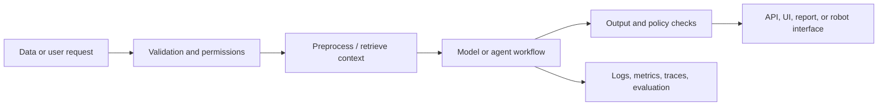

# AI Engineer Capstone Template

Copy this file into a project folder and fill it in before implementation. A strong project proves the complete engineering path, not just a model score.

## 1. Problem and users

- Problem statement:
- Intended users and affected people:
- Prediction/action and when it is needed:
- What a wrong result costs:
- Cases where this system should not be used:

## 2. Requirements and success criteria

- Functional behavior:
- Quality target and metric:
- Latency/throughput target:
- Cost/resource budget:
- Privacy, security, fairness, and accessibility constraints:
- Human review/appeal path:

## 3. Data and governance

- Source, license, permission, and version:
- Row/example meaning and schema:
- Missingness, duplicates, bias, and known limitations:
- Split strategy and leakage checks:
- Data retention/deletion:

## 4. Baseline and experiments

- Simplest baseline:
- Candidate methods:
- Validation plan:
- Experiment log location:
- Error categories and subgroup analysis:
- Final untouched test result and uncertainty:

## 5. System architecture

- Components and owners:
- Model/data/preprocessing versions:
- API/tool contracts:
- State and checkpoint design, if needed:
- External dependencies and fallback behavior:

## 6. Reliability, security, and operations

- Authentication and authorization:
- Secrets and data access:
- Timeouts, retries, idempotency, and rate limits:
- Sandboxing and permissions:
- Monitoring signals and alert owners:
- Incident response and rollback:
- Cost per successful task:

## 7. Reproduction and handoff

- Environment setup:
- Data/model artifact instructions:
- Exact run/evaluation command:
- Expected outputs:
- Known failure modes:
- Follow-up work:

## 8. Acceptance review

- [ ] A second person can reproduce the reported result.
- [ ] The model beats or justifies a meaningful baseline.
- [ ] Data split and evaluation match the intended use.
- [ ] Errors and limitations are documented.
- [ ] The API/agent cannot exceed its permissions.
- [ ] Operational monitoring and rollback are defined.
- [ ] Affected users know when to trust, question, or escalate the result.
