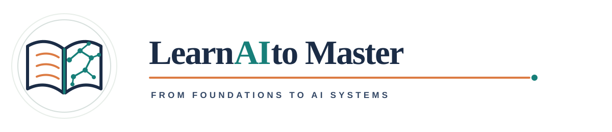

<h1 align="center">
  
</h1>

<p align="center"><strong>Học AI để làm chủ</strong></p>

<p align="center"><a href="../../README.md">English</a> · <strong>Tiếng Việt</strong></p>

<p align="center">Lộ trình học thực hành miễn phí từ nền tảng AI đến Machine Learning, Computer Vision, robotics, Reinforcement Learning và Agentic AI hiện đại.</p>

<p align="center"><strong>Tác giả:</strong> Nguyễn Đình Hiếu</p>

<p align="center"><a href="../../LICENSE"></a></p>

Bản tiếng Anh là curriculum nguồn; README này dẫn vào bản tiếng Việt với cấu trúc bài học, ví dụ, bài tập và project tương ứng. Thuật ngữ chuyên ngành, tên thư viện, API, class/function và code được giữ bằng tiếng Anh khi đó là cách dùng chuẩn; phần giải thích được viết bằng tiếng Việt. Tài liệu ưu tiên Markdown và thực hành bằng code.

> **Tình trạng dự án:** Repository có curriculum tiếng Anh và bản tiếng Việt gồm bài học có hướng dẫn, ví dụ giải, bài thực hành, project và cheat sheet. Nội dung có thể tiếp tục được mở rộng bằng bài tập chuyên sâu và walkthrough project.

## Dành cho ai

- Người mới muốn có lộ trình rõ ràng thay vì tự ghép các nguồn rời rạc.
- Lập trình viên muốn hiểu nền tảng và cách xây dựng hệ thống AI.
- Người học muốn đi sâu vào Computer Vision, robotics, language model hoặc Reinforcement Learning.

Bạn không cần biết toán nâng cao trước khi bắt đầu. Lộ trình giới thiệu từng phần toán khi chúng trở nên cần thiết. Biết sử dụng máy tính cơ bản và sẵn sàng viết Python là đủ để bắt đầu.

## Bắt đầu học

1. Đọc [cách sử dụng lộ trình](curriculum/00-start-here/01-how-to-use-this-path.md).
2. Theo dõi [bản đồ curriculum](curriculum/README.md) và [roadmap](ROADMAP.md).
3. Bắt đầu với [Python và computing](curriculum/02-python/README.md), đồng thời ôn các chủ đề toán khi cần.
4. Ghi chú, tự chạy bài tập và xây các project nhỏ trong quá trình học.

Dùng [cheat sheet AI](CHEATSHEET.md) để tra nhanh công thức, metric, shape và workflow. Nên học bài giảng và làm ví dụ trước; cheat sheet chỉ để ôn tập, không thay thế phần giải thích và thực hành.

## Các chặng học

| Chặng | Chủ đề | Bạn sẽ học cách |
| --- | --- | --- |
| 0 | [Bắt đầu tại đây](curriculum/00-start-here/README.md) | Đặt mục tiêu, thiết lập cách học và điều hướng tài liệu. |
| 1 | [Python và computing](curriculum/02-python/README.md) | Viết Python rõ ràng và dùng các công cụ phổ biến trong AI. |
| 2 | [Toán cho AI](curriculum/01-math/README.md) | Vận dụng đại số tuyến tính, calculus, xác suất, thống kê và tối ưu hóa. |
| 3 | [Xử lý dữ liệu và data engineering](curriculum/03-data/README.md) | Làm sạch, kiểm định, truy vấn và xây pipeline batch, streaming, feature. |
| 4 | [Machine Learning](curriculum/04-machine-learning/README.md) | Huấn luyện, đánh giá và giải thích các model ML cổ điển. |
| 5 | [Deep Learning](curriculum/05-deep-learning/README.md) | Xây neural network và hiểu quá trình huấn luyện. |
| 6 | [Computer Vision](curriculum/06-computer-vision/README.md) | Xử lý ảnh và video từ phương pháp cổ điển đến deep model. |
| 7 | [3D Vision và robotics](curriculum/07-3d-vision-robotics/README.md) | Kết nối camera, geometry, point cloud, ROS 2 và robot perception. |
| 8 | [NLP, LLM và Generative AI](curriculum/08-nlp-llms/README.md) | Học biểu diễn văn bản, transformer, rồi xây và đánh giá ứng dụng LLM. |
| 9 | [Reinforcement Learning](curriculum/09-reinforcement-learning/README.md) | Mô hình hóa quyết định tuần tự và huấn luyện agent bằng phản hồi. |
| 10 | [Agentic AI](curriculum/10-agentic-ai/README.md) | Xây workflow có skill, tool, state, framework và runtime. |
| 11 | [AI Engineering](curriculum/11-ai-engineering/README.md) | Xây phần mềm dễ bảo trì, triển khai và monitor model, vận hành AI system tin cậy. |
| 12 | [Responsible AI](curriculum/12-responsible-ai/README.md) | Đánh giá fairness, privacy, minh bạch, rủi ro lạm dụng và human oversight. |

Chặng 0–5 là nền tảng chung. Sau đó chọn chuyên ngành theo mục tiêu; không cần học mọi chủ đề nâng cao theo một đường thẳng. Học Responsible AI xuyên suốt. AI Engineering hỗ trợ mọi chuyên ngành.

## Cấu trúc repository

```text
.
├── .gitignore
├── README.md
├── CHEATSHEET.md
├── ROADMAP.md
├── LICENSE
├── assets/
│   └── logo.svg
├── curriculum/
│   ├── 00-start-here/
│   ├── 01-math/
│   ├── 02-python/
│   ├── 03-data/
│   ├── 04-machine-learning/
│   ├── 05-deep-learning/
│   ├── 06-computer-vision/
│   ├── 07-3d-vision-robotics/
│   ├── 08-nlp-llms/
│   ├── 09-reinforcement-learning/
│   ├── 10-agentic-ai/
│   ├── 11-ai-engineering/
│   ├── 12-responsible-ai/
│   └── README.md
├── projects/
└── translations/
    ├── README.md
    └── vi/
```

## Cách học hiệu quả

Mỗi môn được chia thành các bài ngắn. Một bài hoàn chỉnh nên nêu mục tiêu, giải thích ý tưởng, trình bày ví dụ giải từng bước, có bài thực hành và chỉ ra lỗi thường gặp. Mỗi module kết thúc bằng project hoặc checkpoint kết hợp các kỹ năng chính.

Lộ trình ưu tiên hiểu bản chất và khả năng tái lập: bắt đầu với dataset nhỏ, lập baseline đơn giản, giữ riêng validation set, ghi lại thí nghiệm và nêu rõ kết quả cho thấy điều gì cũng như giới hạn của nó.

## Bài học chi tiết và công thức

Xem [bản đồ curriculum](curriculum/README.md) để mở bài học theo từng môn và [formula cheatsheet Toán cho AI](curriculum/01-math/FORMULA_CHEATSHEET.md) để tra nhanh công thức.

## Giấy phép

Repository được phát hành theo [MIT License](../../LICENSE).
